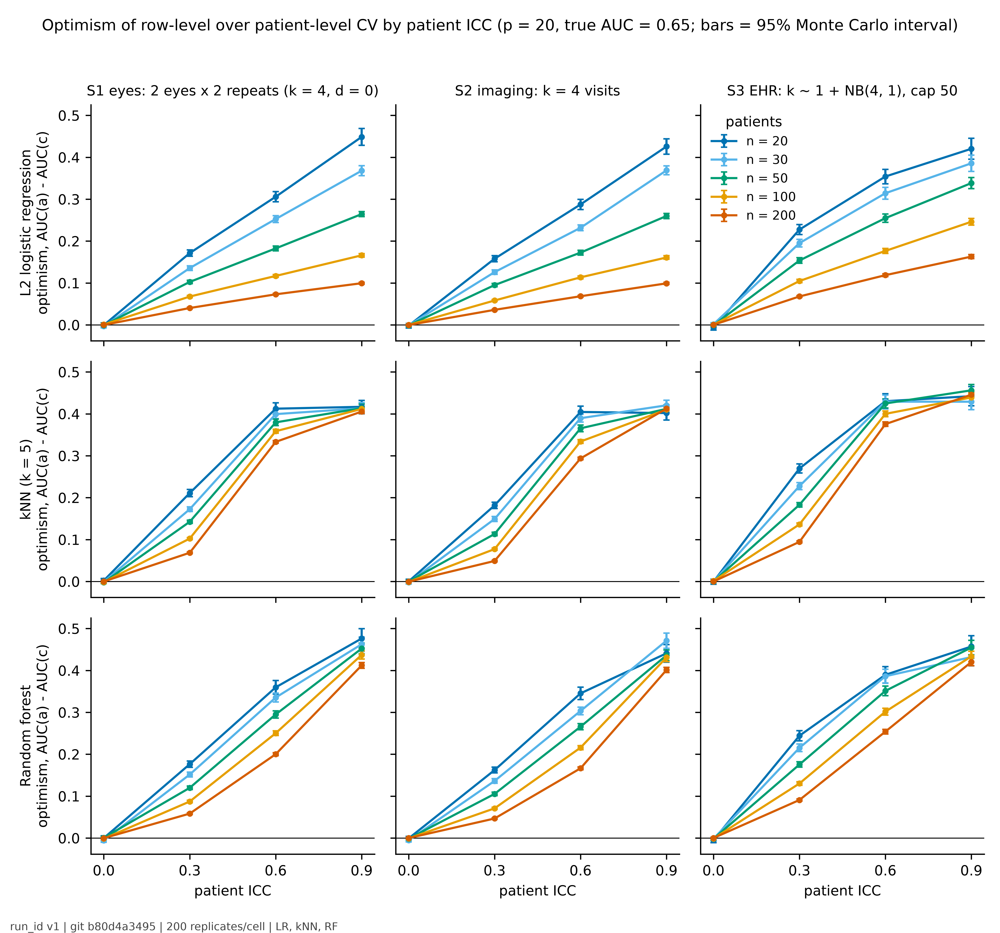

# Sample-Unit Leakage in Clinical ML

Clinical datasets often hold several rows per patient (two eyes, serial scans,
repeated encounters). Splitting those rows at random for cross-validation lets
the model recognise the patient and inflates the AUC. This repository gives a
calculator for the expected inflation, the nomogram it was read from, and a
three-item reporting field. It accompanies our MIE 2027 paper. The 
supplementary figures the paper cites are in supplement/supplement.pdf. 
MIT licence.

## Cite

Rizia MM, Maddess T, Suominen H. Many Rows, Few Patients: A Simulation and
Nomogram for Sample-Unit Leakage in Clinical Machine Learning. MIE 2027, Stud
Health Technol Inform, submitted.

The real-data check uses Reyna MA et al. Early prediction of sepsis from
clinical data: the PhysioNet/Computing in Cardiology Challenge 2019. Crit Care
Med 2020;48(2):210-7, doi:10.1097/CCM.0000000000004145. 
Data: PhysioNet/CinC 2019 v1.0.0, doi:10.13026/v64v-d857, CC BY 4.0; 
no redistribution (see DATA.md).

Numbers from the paper: runs/v1/results.csv or runs/realdemo-v1/table_realdemo-v1.csv.

## Calculator

Python 3, no dependencies.

    git clone https://github.com/riziamm/data-leakage-study.git
    cd data-leakage-study
    python -c "import sys; sys.path.insert(0, 'runs/v1'); from calculator import optimism; \
      print(optimism(n=50, k_mean=5, icc=0.3, p=20, model='lr', true_auc=0.65))"   # 0.120

| input | meaning | range |
|---|---|---|
| n | patients | 20-200 |
| k_mean | mean rows per patient | 1-8 |
| icc | within-patient one-way ICC of the features, mean over features | 0-0.9 |
| p | number of features | 20 or 180 only |
| model | "lr", "knn", "rf" | |
| true_auc | patient-level AUC; default 0.65 | 0.5-0.8 |

Output: expected row-level minus patient-level cross-validated AUC. Subtract
it from a row-level AUC to estimate what a patient-level split would have
given. Outside the ranges it raises ValueError rather than extrapolate.

Accuracy: held-out RMSE 0.013-0.023, maximum error 0.041-0.082 (worst RF,
p = 180); see runs/v1/calculator_report.txt. On the sepsis data, with the
pre-specified mean ICC (0.25), it matched LR within +0.017 to +0.026 and kNN
within -0.047 to +0.010, and under-predicted RF by 0.070-0.100. A corrected
value inherits the ICC's uncertainty and this error. The remedy for a leaky
estimate is a patient-level split, not a correction.

CinC 2019, one row of the check (LR, k = 4, n = 100):

    import sys, pandas as pd; sys.path.insert(0, "runs/v1")
    from calculator import optimism
    t = pd.read_csv("runs/realdemo-v1/table_realdemo-v1.csv")
    r = t[(t.model == "lr") & (t.k == 4) & (t.n == 100)].iloc[0]
    print(r.optimism_observed, r.optimism_se)  # 0.055  0.002
    print(optimism(100, 4, r.icc_mean, 20, "lr", true_auc=r.true_auc_used))  # 0.076

Worked example from the paper: a 5-fold AUC of 0.71 from LR on encounter rows,
50 patients, five rows per patient, split by row, ICC about 0.3. The matching
simulation cell (S3, n = 50, ICC 0.3, p = 20, Figure 1) gives optimism +0.154,
so a patient-level split would have returned about 0.56. The calculator gives
+0.120 for the same inputs; the 0.034 gap is above its RMSE but inside its
maximum error. Read the figure where a cell exists; use the calculator between
cells.

## Nomogram

figures/fig1_nomogram_p20_v1.png (p = 20) and figures/figS1_nomogram_p180_v1.png
(p = 180). Pick the column for the data structure and the row for the
classifier, find the ICC on the x-axis, and read optimism off the line for the
nearest number of patients. Bars are 95% Monte Carlo intervals.
figures/fig2_null_p20_v1.png shows how often a model with no real signal still
reaches AUC 0.70 under a row-level split; grey is the patient-level split.

## Reporting field

Three items for any model report: (1) unit of independence, the entity whose
rows share no information across the train/test boundary; (2) rows per unit,
median and maximum; (3) grouping key, the identifier used to assign whole units
to folds, or "none" if rows were split individually.

| item | paper worked example | CinC 2019 check |
|---|---|---|
| unit of independence | patient | patient |
| rows per unit | median 4, maximum not stated | 4 or 8 by design, from hourly records |
| grouping key | none | patient file id |

To estimate ICC on your own data, fit a one-way random-effects model per
feature with patient as the grouping factor and take the mean.
scripts/realdemo.py has icc_balanced (equal rows per patient, as in the check)
and icc_unbalanced.

## Figures

| paper | file | run_id | code |
|---|---|---|---|
| Figure 1 | figures/fig1_nomogram_p20_v1 | v1 | b80d4a3 |
| Figure 2 | figures/fig2_null_p20_v1 | v1 | b80d4a3 |
| Figure S1, p = 180 nomogram | figures/figS1_nomogram_p180_v1 | v1 | b80d4a3 |
| Figure S2, p = 180 null | figures/figS2_null_p180_v1 | v1 | b80d4a3 |
| Figure S3, CinC 2019 | figures/figS3_obs_vs_pred_realdemo-v1 | realdemo-v1 | supplement/figure_provenance.json |

## Reproduce

Simulation code: tag v1-sim, commit b80d4a3, tag mie2027-submission. 
Python 3.11, scikit-learn 1.9.1; all pins in requirements.lock. 
Simulation data are synthetic. Protocol details in DECISIONS.md.

Run v1 took 1268 core-hours for RF, 21.6 for LR and 7.5 for kNN on the ANU
School of Computing Neuroinformatics cluster, one 250-core CPU node; the
real-data check 3 minutes on 32 cores. Wall times below are for that node.

    # 1. environment, 2 min
    uv venv -p 3.11 .venv && . .venv/bin/activate
    uv pip install -r requirements.lock && uv pip install -e .

    # 2. LR and kNN, 960 cells x 200 replicates, 7 min
    jobs/launch_local.sh v1 250 "lr knn"

    # 3. RF, 5 h; then merge into v1
    CHUNKS=10 jobs/launch_local.sh v1-rf 250 "rf"
    cp -r runs/v1-rf/cells/rf runs/v1/cells/

    # 4. results, test-3 comparator, acceptance tests, 25 min
    python -m mie27.summarise --run-id v1
    python scripts/test3_comparator.py --run-dir runs/v1 --jobs 16
    MIE27_RUN_DIR=runs/v1 python -m pytest -v tests | tee runs/v1/test_output.txt

    # 5. calculator and figures, 2 min
    python -m mie27.build_calculator --run-id v1 | tee runs/v1/calculator_report.txt
    python scripts/figures_v2.py --results runs/v1/results.csv \
        --outdir runs/v1/figs_v2 --models lr knn rf --note "LR, kNN, RF"

    # 6. real-data check (download per DATA.md, 10 min) and supplement, 3 min
    python scripts/realdemo.py --data data/training_setA --jobs 32
    python scripts/make_supplement.py

Every cell's seed is a hash of (base seed 20271, cell id) and all classifiers
see the same data and folds for reproducibility.

Layout: src/mie27 (generate, calibrate, cv, run, summarise, build_calculator,
figures, fast), scripts (test3_comparator, figures_v2, realdemo,
make_supplement), jobs/launch_local.sh, tests (acceptance tests 0-5), runs/v1,
runs/realdemo-v1, figures, supplement, DATA.md, DECISIONS.md.